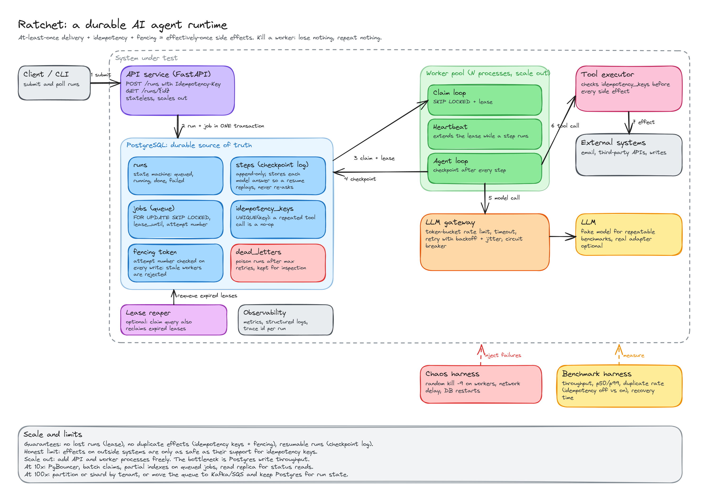

# Ratchet

A durable runtime for AI agents. If a worker dies halfway through a run, the run picks up from the last finished step and nothing that already happened gets done twice.

I'm building this in the open to learn how systems like this actually work: leases, fencing tokens, idempotency, checkpointing, and how to prove the guarantees with failure tests instead of just claiming them.



## The idea

An agent run is a few steps: ask the model, call a tool, ask again. Workers crash. Without care you either lose the run or repeat a side effect, like sending an email twice. Ratchet stores everything that matters in Postgres, hands out work with short leases, saves a checkpoint after every step, and records an idempotency key before every side effect.

The honest version of the guarantee: **at-least-once delivery + idempotency + fencing gives effectively-once side effects.** True exactly-once over a network isn't possible, and effects on outside systems are only as safe as their support for idempotency keys.

## Status

Work in progress. Building in this order:

- [x] Project skeleton and a throwaway local Postgres
- [x] Schema: runs, jobs, steps, idempotency keys, dead letters
- [x] Queue with leases and a fencing token (11 tests, including a stale-worker case)
- [x] Worker loop and heartbeat
- [x] Agent loop with checkpoint and replay
- [x] Idempotent tool calls (and a simulated outside system to test them against)
- [x] LLM gateway (rate limit, retry with backoff and jitter, circuit breaker)
- [x] Chaos harness (random `kill -9`, real worker processes)
- [x] Benchmarks (raw results are in bench/results and chaos/results)
- [ ] API

## Running it

You need Python 3.11+ and a local Postgres install.

```bash
python -m venv .venv
.venv/Scripts/pip install -e ".[dev]"      # on macOS/Linux: .venv/bin/pip
python scripts/dev_db.py start
```

`dev_db.py` creates a throwaway cluster in `.pgdata/` on port 55432, so it won't touch any other database you have.
